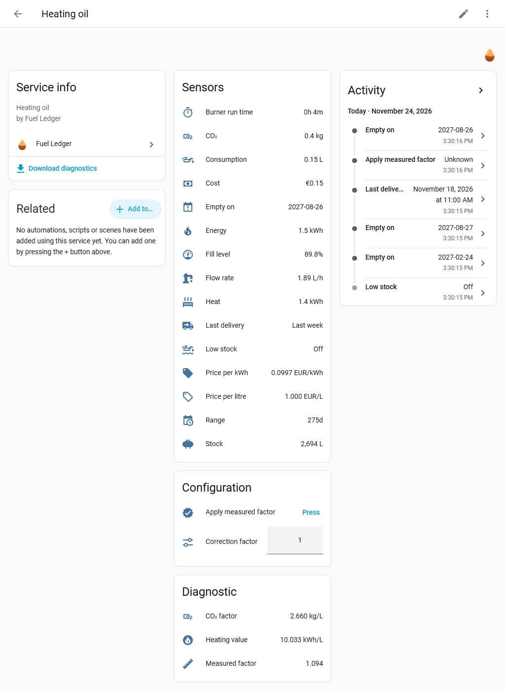

# Fuel Ledger

**Keep the books for your heating oil: how much the burner uses, what is left in the tanks, and what it costs, right
in Home Assistant.**

**Deutsch?** Die ganze Anleitung gibt es [auf Deutsch](https://benep.github.io/fuel_ledger/de/), und auch die
Integration selbst ist übersetzt.

Most oil heatings have no meter. Fuel Ledger works out the consumption from what Home Assistant already knows about
your burner: a run time counter, an on/off sensor, or just a smart plug that measures the power of the boiler. It keeps
track of every tank, blends the price of each delivery with what was left, and corrects itself with the readings you
take with a dipstick.

Step-by-step help: in [English](https://benep.github.io/fuel_ledger/) and in
[German (Deutsch)](https://benep.github.io/fuel_ledger/de/).

## What you get

- **Consumption, energy, heat, cost and CO₂** as counters for the Energy dashboard.
- **The stock** of each tank and of all together, the fill level, the range in days and the day the tanks run empty.
- **Deliveries** with the price, heating value and CO₂ from the invoice, blended with what was left in the tanks.
- **A measured correction factor** from two readings with a dipstick, so the estimate gets better by itself.
- **The burner and the pumps** as sensors of their own, if a power meter sits in front of the boiler.

## What you need

One of these, from best to roughest. Fuel Ledger asks for it in the first step.

| Input | Example |
|---|---|
| **Oil meter** | A meter reading in L or m³. Measured, nothing is calculated. |
| **Burner run time** | A counter in hours from the boiler or a script on a smart plug. |
| **Burner on/off** | A binary sensor that is on while the burner runs. |
| **Power of the heating** | A smart plug or energy meter in front of the boiler, in W. Fuel Ledger finds the burner in it, and the pumps if you tell their power. |

Without an oil meter you also need the **nozzle** of the burner (for example *0.50 GPH*, stamped on it and in the
maintenance record). Everything else is optional: tanks, deliveries, readings, level sensors. You also need **Home
Assistant 2026.10** or newer.

## How it works

Consumption = burner run time × nozzle throughput × correction factor. The correction factor starts at 1 and gets
measured from your dipstick readings. With several tanks joined by a T-piece, the burner draws from the fuller one
first, and Fuel Ledger follows each tank on its own.

More: [How it works](https://benep.github.io/fuel_ledger/how-it-works/).

## An estimate, and honest about it

- **Every result says how it is obtained**: *measured*, *calculated* or *estimated*, in its attribute **Level**.
- **A measurement always wins**: an oil meter replaces the estimate, a level sensor replaces the calculated stock, a
  dipstick reading corrects its tank.
- **Nothing changes backwards.** A new factor, price or heating value counts from the moment it is set, so the Energy
  dashboard never jumps.

## Safe to try

Fuel Ledger only reads. It does not switch anything and does not go online. If you remove it, only its own sensors
disappear.

## Install

1. [Add Fuel Ledger to the Marketplace](https://my.home-assistant.io/redirect/marketplace_repository/?owner=benep&repository=fuel_ledger&category=integration)
   of Home Assistant. By hand: open **Marketplace**, choose **Add from link**, enter
   `https://github.com/benep/fuel_ledger` and choose the type **Integration**.
2. Open **Fuel Ledger** there, click **Install** and restart Home Assistant.
3. Add the integration:

   

Every step with its details: [Installation](https://benep.github.io/fuel_ledger/installation/) and
[Setup](https://benep.github.io/fuel_ledger/setup/).

## Good to know

Fuel Ledger is in **beta**.

- **The counters start with the setup.** For the range, Fuel Ledger reads the days the recorder still has, so it
  shows at once, and deliveries from those days can be entered with their real date.
- **Heating oil only**, for now. The structure is made for more fuels (LPG, pellets, wood).
- **Litres and centimetres** for tanks and readings. The nozzle is in GPH as stamped on it.
- **Heat Ledger** splits the heat between your rooms and can take the **Heat** of Fuel Ledger as its source.

## Help and feedback

- [Questions](https://benep.github.io/fuel_ledger/faq/) answers the common ones.
- Something is wrong, or the numbers look odd? [Open an issue](https://github.com/benep/fuel_ledger/issues) and
  attach the **diagnostics**: on the integration page, the three dots, **Download diagnostics**. It contains your
  setup, the current state of the entities Fuel Ledger reads and its books (deliveries, readings, counters),
  nothing else.

## For developers

[Architecture](docs/architecture.md) and [development](docs/development.md). Fuel Ledger is released under the
[MIT license](LICENSE).
