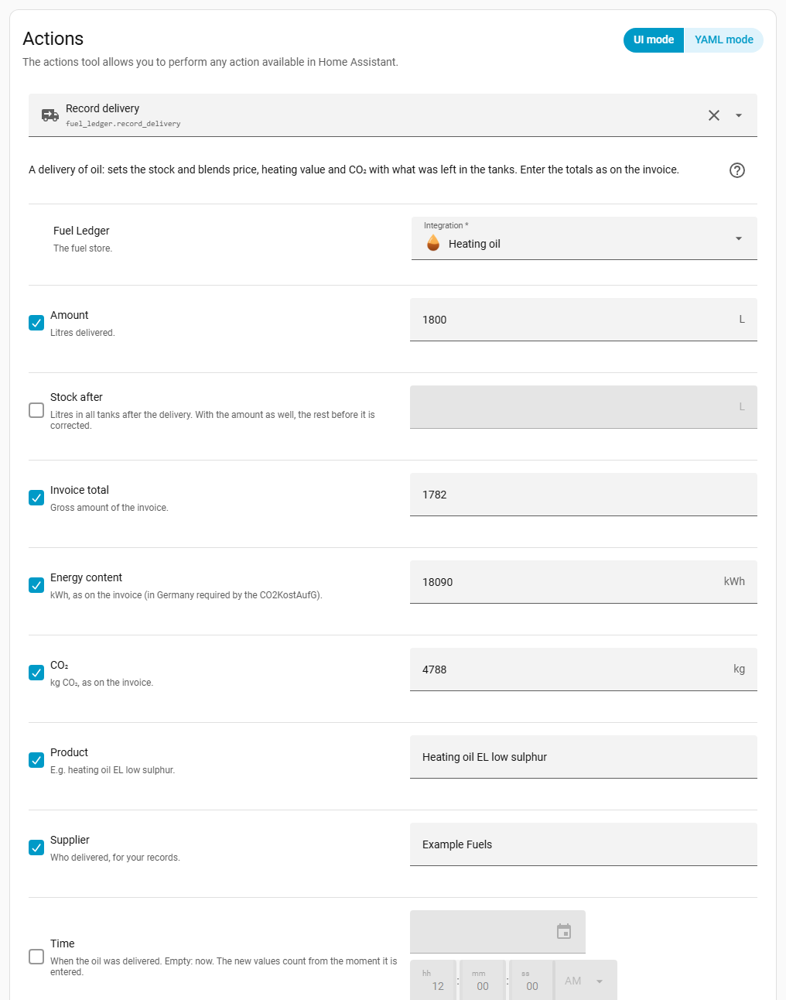

# Lieferungen und Peilungen

!!! abstract "Kurz gesagt"

    - **Eine Lieferung**: Aktion **Lieferung eintragen**, mit der Menge und den Summen der Rechnung. Preis, Heizwert
      und CO₂ werden mit dem gemischt, was noch da war.
    - **Eine Peilung**: Aktion **Pegel eintragen** für jeden Tank, in cm oder Litern, immer an derselben Stelle.
    - **Eine Korrektur** ohne Lieferung: Aktion **Vorrat setzen**, z. B. zum Start.
    - **Der gemessene Faktor** kommt aus zwei vollständigen Peilungen, ein paar Wochen auseinander. Übernimm ihn mit
      dem Knopf **Gemessenen Faktor übernehmen**.
    - Alles lässt sich mit **Zeitpunkt** zurückdatieren.

Die Aktionen findest du unter **Einstellungen → Werkzeuge → Aktionen** (in älteren Versionen **Entwicklerwerkzeuge →
Aktionen**). Suche nach *Fuel Ledger*, füll das Formular aus und klicke auf **Aktion ausführen**. Du kannst sie auch
in Skripten, Automationen und Dashboard-Knöpfen verwenden, siehe [unten](#ein-knopf-auf-dem-dashboard).

{ .screenshot }

## Lieferungen

Wird Öl geliefert, trag es mit **Lieferung eintragen** (`fuel_ledger.record_delivery`) ein:

| Feld | Was du einträgst |
|---|---|
| **Fuel Ledger** | Dein Vorrat. |
| **Liefermenge** | Gelieferte Liter, vom Lieferschein. |
| **Vorrat danach** | Liter in allen Tanks nach der Lieferung, falls du sie gepeilt hast. Mit der Liefermenge dazu wird der Rest davor korrigiert. |
| **Rechnungsbetrag** | Der Bruttobetrag der Rechnung. |
| **Energiegehalt** | kWh, wie auf der Rechnung. In Deutschland schreibt das CO2KostAufG ihn vor. |
| **CO₂** | kg CO₂, wie auf der Rechnung. |
| **Sorte**, **Lieferant** | Für deine Unterlagen. |
| **Zeitpunkt** | Wann das Öl kam. Leer: jetzt. |

Liefermenge oder Vorrat danach, mindestens eins davon. Alles andere ist optional: Ohne die Summen bleiben Preis,
Heizwert und CO₂, wie sie waren.

```yaml
action: fuel_ledger.record_delivery
data:
  config_entry_id: 01J...  # im Formular gewählt
  amount: 1500
  total_price: 1575.00
  energy: 15120
  co2: 3990
```

Die Aktion antwortet mit dem, was sie gebucht hat: dem Rest davor, der Menge, dem Vorrat und Preis, Heizwert und CO₂
danach. Der Sensor **Letzte Lieferung** hält die Menge, den Rest und die Summen als Attribute fest.

??? info "So funktioniert das Mischen"

    Das neue Öl mischt sich mit dem, was noch da war. Jeder Wert wird nach Volumen gemischt:

    ```
    neuer Wert = (Rest × alter Wert + Menge × Wert der Lieferung) ÷ (Rest + Menge)
    ```

    Bei 300 L Rest zu 1,10 €/L und 1200 L Lieferung für 1260 € (1,05 €/L) kostet das Öl in den Tanks
    (300 × 1,10 + 1260) ÷ 1500 = 1,06 €/L. Jeder Liter, der ab dann verbrennt, kostet so viel, bis zur nächsten
    Lieferung.

??? info "Später eingetragen, oder die Menge passt nicht"

    - **Zurückdatiert**: Gib den **Zeitpunkt** der Lieferung an. Der Rest davor wird zu diesem Moment genommen, aus
      dem, was Fuel Ledger bis dahin gezählt hat.
    - **Liefermenge und Vorrat danach**: Der Rest davor ist *Vorrat danach − Liefermenge*. Das korrigiert den Vorrat,
      falls die Schätzung danebenlag.
    - **Nur der Vorrat danach** (kein Lieferschein): Die Menge ist *Vorrat danach − Rest*. Die Summen brauchen dann die
      Liefermenge, weil sie pro Liter umgerechnet werden.

## Peilungen mit dem Peilstab

Eine Peilung eines Tanks mit Peilstab oder Zollstock: **Pegel eintragen** (`fuel_ledger.record_level`).

| Feld | Was du einträgst |
|---|---|
| **Tank** | Das Gerät des Tanks. |
| **Pegel** | Höhe des Öls in cm. Braucht die Liter pro cm des Tanks (oder eine andere Form). |
| **Liter** | Statt der Höhe, falls du Liter abliest (eine Anzeige, eine Tabelle). |
| **Messstelle** | Wo du gemessen hast, z. B. *vorne Mitte*. Verglichen werden nur Peilungen an derselben Stelle. |
| **Zeitpunkt** | Wann du gepeilt hast. Leer: jetzt. |

Eine Peilung setzt den Inhalt dieses Tanks. Sind die Tanks unten verbunden, setzt sie alle. Der Sensor **Letzte
Peilung** des Tanks zeigt sie, und die Aktion antwortet mit dem, was Fuel Ledger für diesen Tank zu diesem Moment
gerechnet hatte: So siehst du, wie weit die Schätzung danebenlag.

!!! tip "Alle Tanks peilen, einen nach dem anderen"

    Der gemessene Faktor nutzt nur vollständige Peilungen: jeder Tank innerhalb von zwei Stunden gepeilt, an denselben
    Stellen wie beim letzten Mal. Peil sie, während der Brenner steht.

??? question "Ab dem Boden gemessen, oder der Tank steht auf etwas?"

    Trag die Peilung so ein, wie du sie misst, und setze im Tank **Leer bei**: den Messwert in cm, wenn der Tank leer
    ist (sein Boden, oder das, worauf er steht). Fuel Ledger zieht ihn ab. Daran sieht es bei Tanks an einem T-Stück
    auch, welche Oberfläche höher steht.

## Der gemessene Faktor

Nach zwei vollständigen Peilungen, mit Brennerlaufzeit dazwischen, zeigt der Sensor **Gemessener Faktor**, was die
Tanks wirklich verloren haben, geteilt durch das, was Fuel Ledger bei Faktor 1 gezählt hat. Seine Attribute zeigen den
Zeitraum, beide Mengen und die Unsicherheit.

- **Je weiter auseinander, desto besser**: ein paar Wochen im Winter, oder ein paar hundert Liter. Über ein paar Tage
  überwiegt die Genauigkeit der Peilungen.
- **Eine Lieferung dazwischen** zählt, mit ihrer Menge.
- **Übernimm ihn** mit dem Knopf **Gemessenen Faktor übernehmen**. Der Korrekturfaktor (eine Zahlen-Entität) hat dann
  den gemessenen Wert, ab jetzt. Du kannst den Korrekturfaktor auch von Hand setzen.

??? info "Wie genau ist das?"

    Jede Peilung ist in der Voreinstellung ±0,5 cm genau (**Vorrat und Reichweite** in den Optionen). Bei 8 L pro cm
    sind das ±4 L pro Peilung, vier Peilungen ergeben also etwa ±8 L. Auf 100 L Verbrauch sind das ±8 % auf den
    Faktor, auf 500 L ±1,6 %. Das Attribut **Unsicherheit** zeigt den Wert für dein Paar.

## Den Vorrat setzen

**Vorrat setzen** (`fuel_ledger.set_stock`) korrigiert den Vorrat ohne Lieferung: zum Start mit dem, was in den Tanks
ist, oder nachdem Öl entnommen wurde. Wahlweise mit **Preis pro Liter**, **Heizwert** und **CO₂-Faktor** des Öls in
den Tanks, die dann ab jetzt gelten.

Bei mehreren Tanks an einem T-Stück wird die Summe nach Annahme auf die Tanks verteilt. Die nächste Peilung jedes
Tanks korrigiert das, die Summe bleibt.

## Ein Knopf auf dem Dashboard

Ein Skript fragt die Werte ab und ruft die Aktion auf. Beispiel für die Peilung eines Tanks:

```yaml
alias: Tankpeilung
fields:
  level:
    name: Pegel (cm)
    required: true
    selector:
      number:
        min: 0
        max: 300
        step: 0.5
        unit_of_measurement: cm
sequence:
  - action: fuel_ledger.record_level
    data:
      device_id: abc123...  # das Gerät des Tanks
      level: "{{ level }}"
      point: vorne Mitte
```

Setz das Skript als Knopf auf ein Dashboard; ein Klick darauf öffnet ein Formular für den Pegel.

## Fehler

Eine falsch eingetragene Lieferung oder Peilung lässt sich noch nicht löschen. Korrigiere sie mit einer neuen Peilung
oder mit **Vorrat setzen**: Das jüngste Ereignis bestimmt den Vorrat ab seinem Zeitpunkt.
