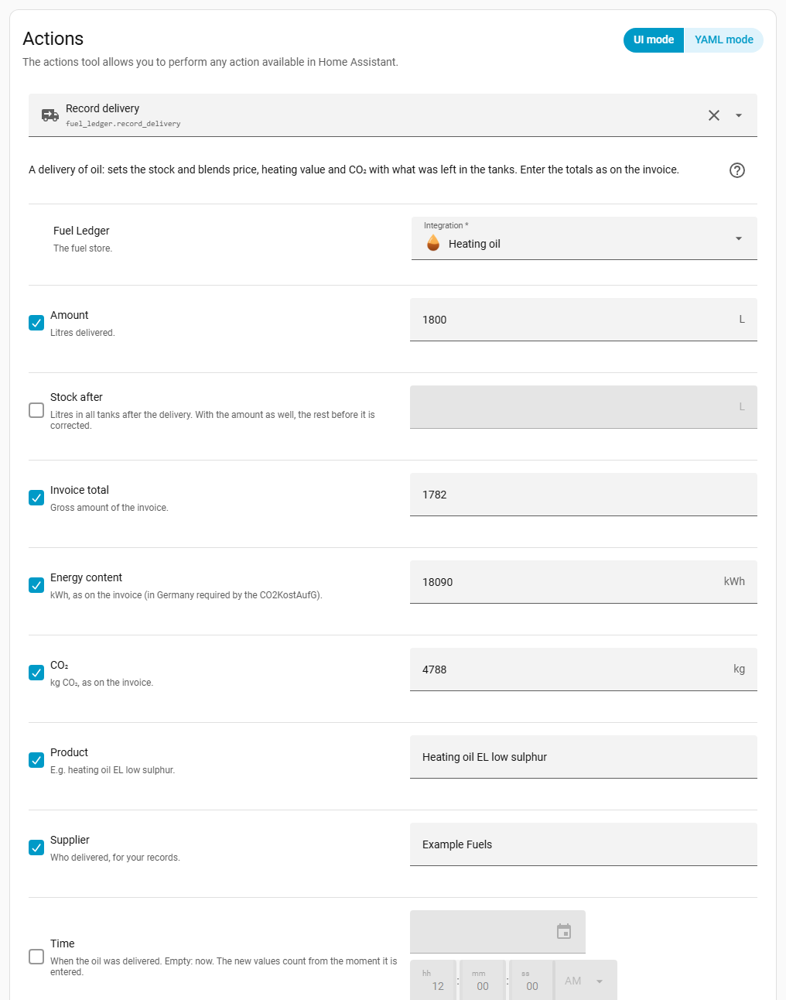

# Deliveries and readings

!!! abstract "In short"

    - **A delivery**: action **Record delivery**, with the amount and the totals of the invoice. Price, heating value
      and CO₂ are blended with what was left.
    - **A reading**: action **Record level** for each tank, in cm or litres, always at the same point.
    - **A correction** without a delivery: action **Set stock**, e.g. to start.
    - **The measured factor** comes from two complete readings some weeks apart. Take it over with the button
      **Apply measured factor**.
    - Everything can be dated back with **Time**.

The actions are in **Settings → Tools → Actions** (in older versions **Developer tools → Actions**). Search for
*Fuel Ledger*, fill in the form, and click **Perform action**. They can also be used in scripts, automations and
dashboard buttons, see [below](#a-button-on-the-dashboard).

{ .screenshot }

## Deliveries

When oil is delivered, enter it with **Record delivery** (`fuel_ledger.record_delivery`):

| Field | What to enter |
|---|---|
| **Fuel Ledger** | Your fuel store. |
| **Amount** | Litres delivered, from the delivery note. |
| **Stock after** | Litres in all tanks after the delivery, if you read them. With the amount as well, the rest before it is corrected. |
| **Invoice total** | The gross amount of the invoice. |
| **Energy content** | kWh, as on the invoice. In Germany the CO2KostAufG requires it. |
| **CO₂** | kg CO₂, as on the invoice. |
| **Product**, **Supplier** | For your records. |
| **Time** | When the oil came. Empty: now. |

Amount or stock after, at least one. Everything else is optional: without the totals, price, heating value and CO₂
stay as they were.

```yaml
action: fuel_ledger.record_delivery
data:
  config_entry_id: 01J...  # chosen in the form
  amount: 1500
  total_price: 1575.00
  energy: 15120
  co2: 3990
```

The action answers with what it booked: the rest before, the amount, the stock, and price, heating value and CO₂
after it. The sensor **Last delivery** keeps the amount, the rest and the totals as attributes.

??? info "How the blending works"

    The new oil mixes with what was left. Each value is blended by volume:

    ```
    new value = (rest × old value + amount × value of the delivery) ÷ (rest + amount)
    ```

    With 300 L left at 1.10 €/L and 1200 L delivered for 1260 € (1.05 €/L), the oil in the tanks costs
    (300 × 1.10 + 1260) ÷ 1500 = 1.06 €/L. Every litre burnt from then on costs that much, until the next delivery.

??? info "Entered later, or the amount does not match"

    - **Dated back**: give the **Time** of the delivery. The rest before it is taken at that moment, from what
      Fuel Ledger counted until then.
    - **Amount and stock after**: the rest before is *stock after − amount*. That corrects the stock if the estimate
      was off.
    - **Only the stock after** (no delivery note): the amount is *stock after − rest*. Totals then need the amount,
      as they are per litre.

## Readings with a dipstick

A reading of one tank with a dipstick or a ruler: **Record level** (`fuel_ledger.record_level`).

| Field | What to enter |
|---|---|
| **Tank** | The device of the tank. |
| **Level** | Height of the oil in cm. Needs the litres per cm of the tank (or another shape). |
| **Litres** | Instead of the height, if you read litres (a gauge, a table). |
| **Measuring point** | Where you measured, e.g. *front middle*. Only readings at the same point are compared. |
| **Time** | When you read it. Empty: now. |

A reading sets the content of that tank. Connected at the bottom, it sets all of them. The sensor **Last reading** of
the tank shows it, and the action answers with what Fuel Ledger had calculated for that tank at that moment: so you
see how far off the estimate was.

!!! tip "Read all tanks, one after the other"

    The measured factor only uses complete surveys: every tank read within two hours, at the same points as last
    time. Read them while the burner stands still.

??? question "Measuring from the floor, or the tank stands on something?"

    Enter the reading as you measure it, and set **Empty at** in the tank: the reading in cm when the tank is empty
    (its bottom, or what it stands on). Fuel Ledger subtracts it. That also tells which surface stands higher for
    tanks on a T-piece.

## The measured factor

After two complete surveys with the burner running in between, the sensor **Measured factor** shows what the tanks
really lost, divided by what Fuel Ledger counted at factor 1. Its attributes show the period, both amounts and the
uncertainty.

- **The longer apart, the better**: a few weeks in winter, or a few hundred litres. Over a few days, the accuracy of
  the readings dominates.
- **A delivery in between** counts, with its amount.
- **Take it over** with the button **Apply measured factor**. The correction factor (a number entity) then has the
  measured value, from now on. You can also set the correction factor by hand.

??? info "How exact is it?"

    Each reading is ±0.5 cm by default (**Stock and range** in the options). At 8 L per cm that is ±4 L per reading,
    so four readings give about ±8 L. Over 100 L of consumption that is ±8 % on the factor, over 500 L ±1.6 %. The
    attribute **Uncertainty** shows the value for your pair.

## Setting the stock

**Set stock** (`fuel_ledger.set_stock`) corrects the stock without a delivery: to start with what is in the tanks,
or after oil was taken out. Optionally with **Price per litre**, **Heating value** and **CO₂ factor** of the oil in the
tanks, which then count from now on.

With several tanks on a T-piece, the total is spread over the tanks by assumption. The next reading of each tank
corrects it, while the total stays.

## A button on the dashboard

A script asks for the values and calls the action. Example for a reading of one tank:

```yaml
alias: Tank reading
fields:
  level:
    name: Level (cm)
    required: true
    selector:
      number:
        min: 0
        max: 300
        step: 0.5
        unit_of_measurement: cm
sequence:
  - action: fuel_ledger.record_level
    data:
      device_id: abc123...  # the device of the tank
      level: "{{ level }}"
      point: front middle
```

Add the script to a dashboard as a button; clicking it opens a form for the level.

## Mistakes

A delivery or reading entered wrongly cannot be deleted yet. Correct it with a new reading or **Set stock**: the
latest event decides the stock from its moment on.
