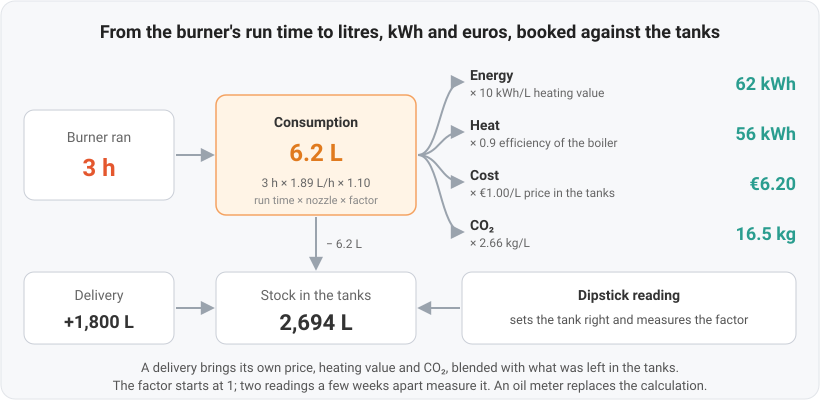
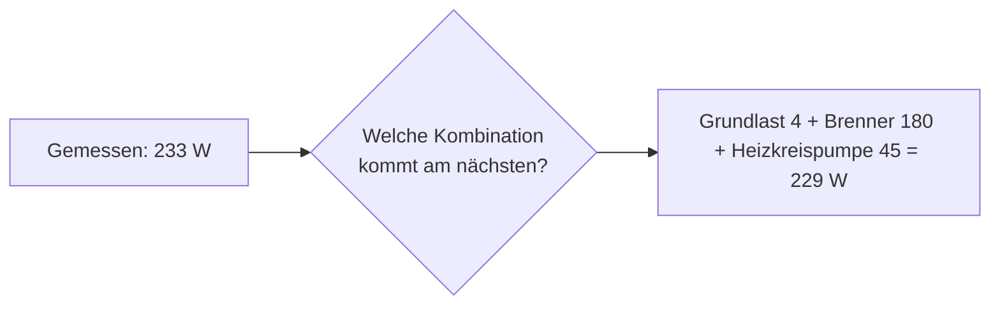
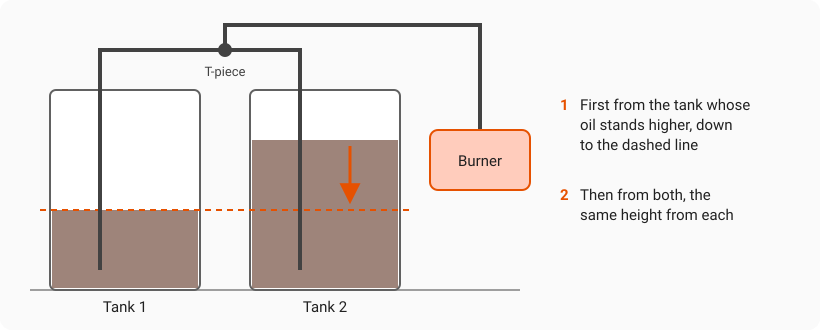
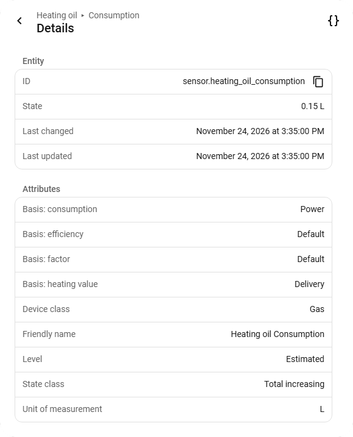

# So funktioniert es

Um Fuel Ledger zu nutzen, musst du diese Seite nicht lesen. Sie hilft zu verstehen, warum die Zahlen so sind, wie sie
sind.

!!! abstract "Kurz gesagt"

    - **Verbrauch** = Brennerlaufzeit × Durchsatz der Düse × Korrekturfaktor. Ein Ölzähler ersetzt das alles.
    - **Eine Leistungsmessung** vor dem Kessel genügt: Fuel Ledger findet den Brenner und die Pumpen in ihrer Summe.
    - **Jeder Tank** behält seinen eigenen Inhalt. Hängen sie an einem T-Stück, saugt der Brenner zuerst aus dem
      volleren Tank.
    - **Eine Lieferung** mischt Preis, Heizwert und CO₂ mit dem, was noch in den Tanks war.
    - **Zwei Peilungen** messen den Korrekturfaktor.
    - **Nichts ändert sich rückwirkend**: Neue Werte gelten ab dem Moment, in dem sie gesetzt werden.

{ .diagram }

## Von der Laufzeit zu den Litern

Ein einstufiger Brenner verbrennt in jeder Stunde, die er läuft, dieselbe Menge Öl. Diese Menge steht auf seiner Düse,
in US-Gallonen pro Stunde (GPH):

```
Liter pro Stunde = GPH × 3,785 × √(Pumpendruck ÷ Prüfdruck) × Korrekturfaktor
```

- **GPH × 3,785** rechnet Gallonen in Liter um: Eine Düse mit 0.50 GPH ergibt 1,89 L/h.
- **Der Pumpendruck** zählt, weil eine Düse für 7 bar (100 psi) angegeben ist, viele Ölpumpen aber mit 10 bis 14 bar
  laufen. Bei 10 bar sprüht eine Düse mit 0.50 GPH etwa 2,26 L/h. Kennst du den Druck (Wartungsprotokoll, Manometer
  an der Pumpe), trag ihn ein.
- **Der Korrekturfaktor** deckt den Rest ab: die Toleranz der Düse, die Temperatur des Öls, einen Druck, den du nicht
  kennst. Er beginnt bei 1 und wird [aus deinen Peilungen gemessen](#der-gemessene-faktor).

Fuel Ledger zählt die Laufzeit aus dem, was du ihm gibst:

| Eingang | Wie die Laufzeit ermittelt wird |
|---|---|
| **Ölzähler** | Gar nicht nötig: Der Zähler misst Liter. |
| **Brennerlaufzeit** | Der Zuwachs des Zählers. Er zählt weiter, auch wenn Home Assistant nicht läuft. |
| **Brenner an/aus** | Fuel Ledger zählt die Zeit, in der der Sensor an ist, abzüglich der **Vorbelüftung** jedes Starts (der Sekunden, in denen das Gebläse läuft, bevor Öl brennt). |
| **Leistung der Heizung** | Der Brenner wird in der Leistung erkannt, siehe unten. Dann wie bei an/aus. |

??? info "Zähler, die springen, neu anfangen oder fehlen"

    Ein Laufzeitzähler oder Ölzähler wird so gelesen, wie Home Assistant jeden Zähler liest: Ein Anstieg zählt, ein
    Abfall auf viel weniger (unter 90 %) ist ein neuer Zähler ab 0, ein kleiner Abfall wird zurückgehalten, bis der
    Zähler ihn wieder aufgeholt hat. Eine Ausnahme: Ein Gerät, das nach einem Neustart kurz 0 meldet und dann wieder
    seinen alten Stand, gilt nicht als neuer Zähler. Solange ein Sensor nicht verfügbar ist, wird nichts gezählt; ein
    Laufzeitzähler holt das von selbst auf, ein An/aus-Sensor oder eine Leistungsmessung kann das nicht.

## Die Leistungsmessung: Brenner und Pumpen aus einer Zahl

Viele Heizungen haben eine einzige Messsteckdose oder einen Stromzähler vor dem Kessel. Er misst alles zusammen: die
Kesselregelung, den Brenner (Gebläse, Ölpumpe, Zündung), die Ölvorwärmung und die Pumpen. Jedes davon zieht eine
typische Leistung, also verrät die Summe, welche davon laufen.



- Fuel Ledger probiert jede Kombination durch und nimmt die, deren typische Leistungen zusammen der Messung am nächsten
  kommen. Von zwei gleich nahen nimmt es die mit weniger Komponenten.
- **Die Ölvorwärmung läuft nie mit dem Brenner**: Sie wärmt das Öl, bevor der Brenner startet.
- **Eine Pumpe muss sich eine Weile zeigen**, bevor sie als laufend gilt (in der Voreinstellung 60 s), und eine Weile
  weg sein, bevor sie als stehend gilt (120 s). Die kurze Spitze der Zündung wird nicht für eine Pumpe gehalten. Ein
  bestätigter Wechsel zählt ab dem Moment, in dem er begann.
- **Der Brenner zählt sofort**, seine Laufzeit wird laufend gebucht.
- Was die Messung über oder unter den typischen Leistungen liegt, geht an den Brenner, solange er läuft: Sein Bedarf
  schwankt am meisten.

Jede Komponente bekommt einen Binärsensor, ob sie läuft, und einen Sensor für ihre Leistung. Ist nur der Brenner
bekannt, gilt er als laufend oberhalb einer Schwelle auf halbem Weg zwischen Grundlast und seiner Leistung.

??? info "Pumpen, die fast gleich viel ziehen"

    Zwei Komponenten, deren typische Leistungen weniger als 5 W (oder 10 %) auseinanderliegen, lassen sich nicht
    unterscheiden: Die Summe ist in beiden Fällen dieselbe. Fuel Ledger meldet das dann unter **Einstellungen → System
    → Reparaturen**. Der Brenner wird weiter richtig gezählt, solange er nicht einer der beiden ist; nur welche der
    beiden als laufend erscheint, ist geraten.

    Eine kleine Pumpe, die du weglässt, schadet nicht, solange sie weniger zieht als die Hälfte des kleinsten
    Unterschieds zwischen den anderen: Ihre Leistung kippt die Wahl dann nie.

## Tanks

Jeder Tank behält seinen eigenen Inhalt. Wie sie verbunden sind, entscheidet, wohin das Öl geht:

| Verbunden | Was passiert |
|---|---|
| **Unten** (Batterietanks mit Verbindungsleitung) | Das Öl steht in allen gleich hoch. Eine Peilung gilt für alle. |
| **Nur über die Saugleitungen** (ein T-Stück vor dem Brenner) | Jeder Tank behält seinen eigenen Pegel. Der Brenner saugt aus dem Tank, in dem das Öl höher steht, bis beide gleich hoch stehen, dann aus beiden. |

{ .diagram }

Warum aus dem volleren? Bei dem kleinen Durchfluss eines Brenners hat die Saugleitung aus dem Tank mit der höheren
Öloberfläche etwas mehr Druck und fördert. Die Höhe zählt ab dem Boden, also zählt ein Tank, der auf einem Sockel
steht, mit seiner Oberfläche, nicht mit seinem Inhalt (trag den Sockel im Tank als **Leer bei** ein).

??? info "Lieferungen in Tanks an einem T-Stück"

    Wie sich eine Lieferung auf Tanks verteilt, die unten nicht verbunden sind, weiß man nicht: Es hängt davon ab, wie
    die Füllleitungen verlegt sind. Fuel Ledger füllt zuerst die niedrigeren Oberflächen auf und markiert die Tanks als
    *angenommen*. Die nächste Peilung eines Tanks behält die Summe bei und gibt den anderen den Rest; sobald jeder
    Tank gepeilt ist, entscheiden die Peilungen.

## Lieferungen: Preis, Heizwert und CO₂ mischen

Wird Öl geliefert, mischt sich das neue Öl mit dem, was noch da war. Fuel Ledger mischt nach Volumen:

```
neuer Wert = (Rest × alter Wert + Menge × Wert der Lieferung) ÷ (Rest + Menge)
```

für den **Preis pro Liter**, den **Heizwert** (kWh pro Liter) und den **CO₂-Faktor** (kg pro Liter). Die Werte der
Lieferung kommen von der Rechnung: ihr Betrag, ihr Energiegehalt und ihr CO₂. Die gemischten Werte gelten für jeden
Liter, der ab dann verbrennt. So bleiben die Kosten im Energie-Dashboard über Lieferungen hinweg richtig, ohne dass
jemand einen Preis von Hand einträgt.

## Der gemessene Faktor

Zwei Peilungen aller Tanks, ein paar Wochen auseinander, zeigen, wie viel Öl der Brenner wirklich verbraucht hat.
Fuel Ledger weiß, wie viel er in derselben Zeit bei Faktor 1 verbraucht hätte. Das Verhältnis ist der **gemessene
Faktor**:

```
gemessener Faktor = Liter, die die Tanks verloren haben ÷ Liter bei Faktor 1
```

- **Nur vollständige Peilungen zählen**: jeder Tank gepeilt, einer nach dem anderen innerhalb von zwei Stunden, beide
  Male an denselben Messstellen. Eine Peilung von einer anderen Seite eines Tanks ist nicht vergleichbar (Böden sind
  schief, Tanks stehen schräg).
- **Eine Lieferung dazwischen zählt** mit ihrer Menge.
- **Je weiter auseinander, desto besser.** Von allen Paaren gewinnt das mit dem meisten Verbrauch dazwischen. Der
  Sensor **Gemessener Faktor** zeigt seine Unsicherheit, aus der Genauigkeit deiner Peilungen (in der Voreinstellung
  ±0,5 cm).
- **Du entscheidest**, wann er übernommen wird: mit dem Knopf **Gemessenen Faktor übernehmen**. Er gilt ab dann.

## Stufen: Wie gut ist eine Zahl?

Jedes Ergebnis sagt in seinem Attribut **Stufe**, wie es zustande kommt:

| Stufe | Bedeutet |
|---|---|
| *gemessen* | Von einem Zähler oder Sensor: ein Ölzähler, Füllstandssensoren an allen Tanks. |
| *berechnet* | Aus bekannten Werten: ein gemessener Faktor, der Heizwert einer Rechnung. |
| *geschätzt* | Etwas darin ist ein Vorgabewert: der Faktor 1, der Heizwert von 10 kWh/L, der Wirkungsgrad von 90 %. |

Die Attribute **Grundlage: Verbrauch**, **Faktor**, **Heizwert** und **Wirkungsgrad** sagen, woher jeder Eingang
kommt: *Standard*, *Eingegeben*, *Lieferung* oder *Gemessen*. [Genauer machen](more-accurate.md) zeigt, wie du eine Zahl
eine Stufe nach oben bringst.

{ .screenshot }

## Nichts ändert sich rückwirkend

Ein neuer Korrekturfaktor, Heizwert, Preis oder Wirkungsgrad des Kessels gilt ab dem Moment, in dem er gesetzt wird.
Was vorher gezählt wurde, bleibt. So springt das Energie-Dashboard nicht, und eine Statistik, die du dir letzten Monat
angesehen hast, zeigt immer noch dasselbe.

Ereignisse kannst du aber zurückdatieren: eine Peilung, die du am Tag danach einträgst, eine Lieferung, die eine Woche
später eingetragen wird. Fuel Ledger rechnet den Vorrat dann ab diesem Moment neu, mit dem Verbrauch, den es
dazwischen aufgezeichnet hat. Ihre neuen Werte (Preis, Heizwert) gelten trotzdem erst ab dem Eintragen.

??? info "Vor der Einrichtung"

    Beim ersten Start liest Fuel Ledger die Zustände seines Eingangs aus den Tagen, die der Recorder von Home
    Assistant noch hat (standardmäßig 10, höchstens 30), und rechnet daraus den Verbrauch jeder Stunde, nach denselben
    Regeln wie im Betrieb. So gibt es die Reichweite sofort, und eine Lieferung oder Peilung aus diesen Tagen lässt
    sich mit ihrem echten Datum eintragen. Die Zähler für das Energie-Dashboard beginnen trotzdem mit der Einrichtung
    bei 0.
