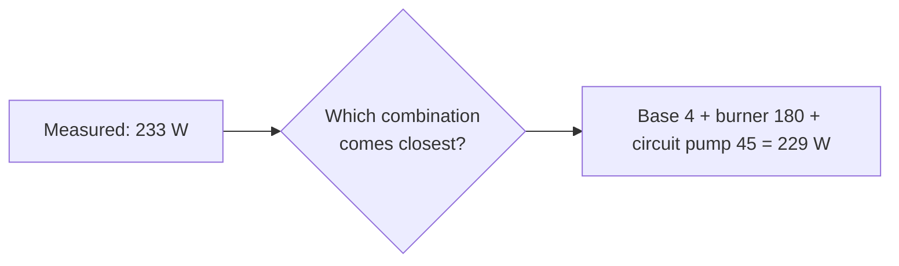
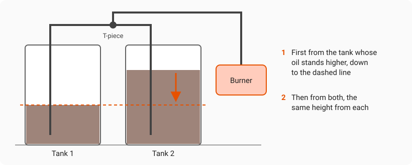

# How it works

You do not need to read this page to use Fuel Ledger. It helps to understand why the numbers are what they are.

!!! abstract "In short"

    - **Consumption** = burner run time × nozzle throughput × correction factor. An oil meter replaces all of it.
    - **A power meter** in front of the boiler is enough: Fuel Ledger finds the burner and the pumps in its total.
    - **Each tank** keeps its own content. Joined by a T-piece, the burner draws from the fuller tank first.
    - **A delivery** blends price, heating value and CO₂ with what was left in the tanks.
    - **Two dipstick readings** measure the correction factor.
    - **Nothing changes backwards**: new values count from the moment they are set.

## From run time to litres

A burner with one stage burns the same amount of oil every hour it runs. That amount is stamped on its nozzle, in US
gallons per hour (GPH):

```
litres per hour = GPH × 3.785 × √(pump pressure ÷ test pressure) × correction factor
```

- **GPH × 3.785** turns gallons into litres: a 0.50 GPH nozzle gives 1.89 L/h.
- **The pump pressure** matters because a nozzle is rated at 7 bar (100 psi), but many oil pumps run at 10 to 14 bar.
  At 10 bar a 0.50 GPH nozzle sprays about 2.26 L/h. If you know the pressure (maintenance record, gauge on the
  pump), enter it.
- **The correction factor** covers the rest: the tolerance of the nozzle, the oil's temperature, a pressure you do not
  know. It starts at 1 and is [measured from your dipstick readings](#the-measured-factor).

Fuel Ledger counts the run time from what you give it:

| Input | How the run time is found |
|---|---|
| **Oil meter** | Not needed: the meter measures litres. |
| **Burner run time** | The counter's increase. It keeps counting while Home Assistant is down. |
| **Burner on/off** | Fuel Ledger counts the time the sensor is on, minus the **prepurge** of each start (the seconds the fan runs before any oil burns). |
| **Power of the heating** | The burner is recognised in the power, see below. Then like on/off. |

??? info "Counters that jump, restart or go missing"

    A run time counter or oil meter is read the way Home Assistant reads any counter: an increase counts, a drop to
    much less (below 90 %) is a new counter from 0, a small drop is held back until the counter has made up for it.
    One exception: a device that reports 0 for a moment after a restart and then its old reading again is not taken
    for a new counter. While a sensor is unavailable, nothing is counted; a run time counter catches up by itself,
    an on/off sensor or a power meter cannot.

## The power meter: burner and pumps from one number

Many heatings have a single smart plug or energy meter in front of the boiler. It measures everything together: the
boiler's control, the burner (fan, oil pump, ignition), the oil preheater and the pumps. Each of them draws a
typical power, so the total tells which of them run.



- Fuel Ledger tries every combination and takes the one whose typical powers add up closest to the measurement. Of
  two equally close ones, it takes the one with fewer components.
- **The oil preheater never runs with the burner**: it warms the oil before the burner starts.
- **A pump has to show for a while** before it counts as running (60 s by default) and be gone for a while before it
  counts as stopped (120 s). The short peak of the ignition is not taken for a pump. A confirmed change counts from
  when it began.
- **The burner counts at once**, its run time is booked as it goes.
- What the measurement has above or below the typical powers goes to the burner while it runs: its draw varies most.

Each component gets a binary sensor whether it runs, and a sensor for its power. With only the burner known, the burner
counts as running above a threshold halfway between the base load and its power.

??? info "Pumps that draw almost the same"

    Two components whose typical powers are within 5 W (or 10 %) of each other cannot be told apart: the total is the
    same either way. Fuel Ledger then raises a repair note under **Settings → System → Repairs**. The burner is still
    counted correctly as long as it is not one of the two; only which of the two shows as running is a guess.

    A small pump you leave out does no harm as long as it draws less than half of the smallest difference between
    the others: its power then never tips the choice.

## Tanks

Each tank keeps its own content. How they are connected decides where the oil goes:

| Connected | What happens |
|---|---|
| **At the bottom** (battery tanks with a connecting pipe) | The oil stands at the same height in all of them. One reading tells all. |
| **Only through their suction pipes** (a T-piece in front of the burner) | Each tank keeps its own level. The burner draws from the tank whose oil stands higher, until both stand at the same height, then from both. |

{ .diagram }

Why the fuller one? At the small flow of a burner, the suction pipe from the tank with the higher oil surface has a
little more pressure and delivers. The height counts from the floor, so a tank standing on a base counts with its
surface, not its content (enter the base as **Empty at** in the tank).

??? info "Deliveries into tanks on a T-piece"

    How a delivery spreads over tanks that are not connected at the bottom is not known: it depends on how the
    filling pipes are laid. Fuel Ledger fills the lower surfaces first and marks the tanks as *assumed*. The next
    reading of one tank keeps the total and gives the others the rest; once every tank has been read, the readings
    decide.

## Deliveries: blending price, heating value and CO₂

When oil is delivered, the new oil mixes with what was left. Fuel Ledger blends by volume:

```
new value = (rest × old value + amount × value of the delivery) ÷ (rest + amount)
```

for the **price per litre**, the **heating value** (kWh per litre) and the **CO₂ factor** (kg per litre). The values
of the delivery come from the invoice: its total, its energy content and its CO₂. The blended values count for every
litre burnt from then on. So the cost in the Energy dashboard stays right across deliveries, without anyone
entering a price by hand.

## The measured factor

Two readings of all tanks, some weeks apart, show how much oil the burner really used. Fuel Ledger knows how much it
would have used at factor 1 in the same time. The ratio is the **measured factor**:

```
measured factor = litres the tanks lost ÷ litres at factor 1
```

- **Only complete surveys count**: every tank read, one after the other within two hours, at the same measuring
  points both times. A reading from another side of a tank is not comparable (floors slope, tanks lean).
- **A delivery in between counts** with its amount.
- **The longer apart, the better.** Of all pairs, the one with the most consumption between them wins. The
  sensor **Measured factor** shows its uncertainty, from the accuracy of your readings (±0.5 cm by default).
- **You decide** when to take it over: the button **Apply measured factor**. It counts from then on.

## Levels: how good is a number?

Every result states in its attribute **Level** how it is obtained:

| Level | Means |
|---|---|
| *measured* | From a meter or sensor: an oil meter, level sensors on all tanks. |
| *calculated* | From known values: a measured factor, the heating value of an invoice. |
| *estimated* | Something in it is a default: the factor 1, the heating value of 10 kWh/L, the efficiency of 90 %. |

The attribute **Basis** says where each input comes from. [More accurate](more-accurate.md) shows how to move a
number up.

## Nothing changes backwards

A new correction factor, heating value, price or boiler efficiency counts from the moment it is set. What was counted
before stays. That keeps the Energy dashboard from jumping, and a statistic you looked at last month still shows
the same.

Events can be dated back, though: a reading you enter the day after, a delivery entered a week later. Fuel Ledger
then works out the stock from that moment on again, with the consumption it recorded in between. Their new values
(price, heating value) still only count from when you enter them.

??? info "Before the setup"

    At the first start, Fuel Ledger reads the states of its input from the days the recorder of Home Assistant still
    has (10 by default, at most 30) and works out the consumption of each hour, with the same rules as live. That
    gives the range at once, and a delivery or reading from those days can be entered with its real date. The
    counters for the Energy dashboard still start at 0 with the setup.
