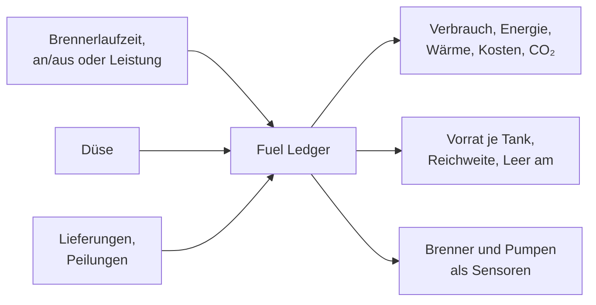
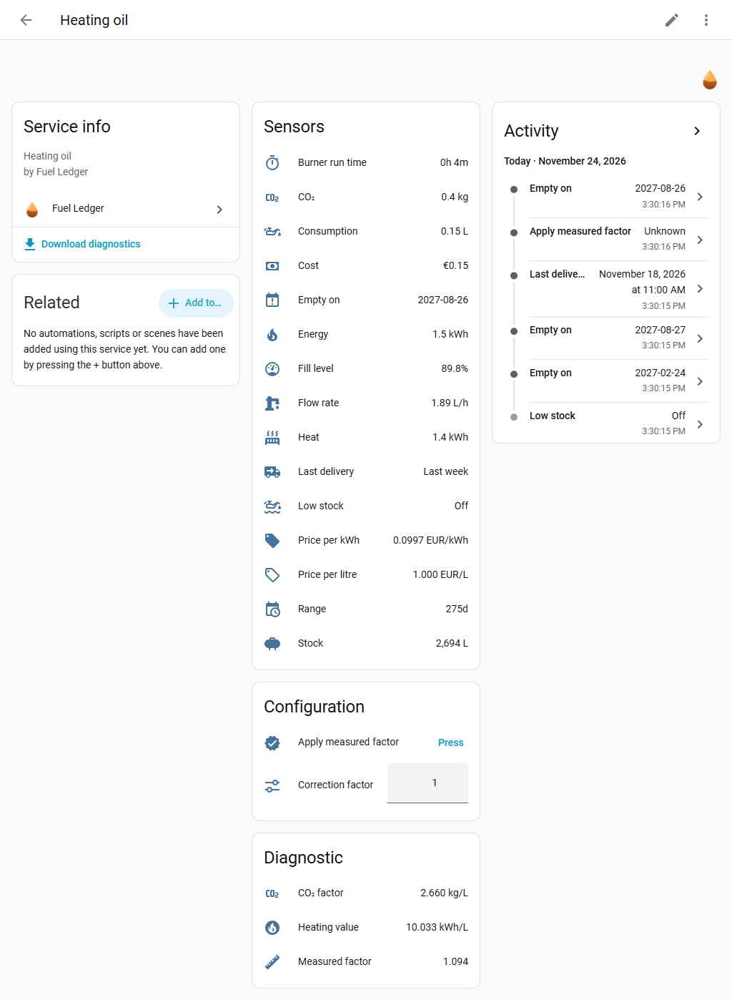

# Fuel Ledger

**Wie viel Öl verbraucht deine Heizung, und wie lange reichen die Tanks?** Die meisten Ölheizungen haben keinen
Zähler. Fuel Ledger rechnet es aus dem aus, was Home Assistant schon über deinen Brenner weiß, führt Buch über jeden
Tank und jede Lieferung und korrigiert sich selbst mit den Peilungen, die du mit dem Peilstab machst.

## Was du bekommst

- **Zähler für das Energie-Dashboard**: Verbrauch in Litern, Energie und Wärme in kWh, Kosten und CO₂.
- **Den Vorrat** jedes Tanks und aller zusammen, den Füllgrad, die Reichweite in Tagen und den Tag, an dem die Tanks
  leer sind.
- **Lieferungen** mit Preis, Heizwert und CO₂ von der Rechnung, gemischt mit dem, was noch in den Tanks war.
- **Einen gemessenen Korrekturfaktor** aus deinen Peilungen.
- **Den Brenner und die Pumpen** als eigene Sensoren, wenn eine Leistungsmessung vor dem Kessel sitzt.

{ .screenshot }

## Was du brauchst

- :material-home-assistant: **Home Assistant 2026.10 oder neuer**

- :material-fire: **Etwas, das meldet, wann der Brenner läuft**

    Einen Laufzeitzähler, einen Binärsensor oder die Leistung des Kessels von einer Messsteckdose. Oder einen
    Ölzähler, falls du einen hast.

- :material-spray: **Die Düse des Brenners**

    Auf der Düse aufgedruckt und im Wartungsprotokoll, zum Beispiel *0.50 GPH*. Mit einem Ölzähler nicht nötig.

Optional, und jedes davon macht es genauer: die Tanks mit ihrer Größe, die Rechnungen deiner Lieferungen, Peilungen
mit dem Peilstab, ein Füllstandssensor. [Genauer machen](more-accurate.md) zeigt, was jedes davon bringt.

## Passt das zu deiner Heizung?

- :material-check: **Passt:** eine Ölheizung mit einem Brenner, der mit einer Leistung läuft (einstufig), und
  irgendein Weg, auf dem Home Assistant erfährt, wann er läuft. Die meisten Ölkessel sind so.
- :material-check: **Passt ungefähr:** ein zweistufiger oder modulierender Brenner. Die Düse gibt den Verbrauch bei
  voller Leistung an; der gemessene Faktor bringt ihn näher heran, aber es bleibt ein Mittelwert.
- :material-close: **Passt noch nicht:** Flüssiggas, Pellets, Holz. Der Aufbau ist dafür gemacht, sie kommen später.

!!! info "Eine Schätzung, und ehrlich dazu"

    Ohne Ölzähler rechnet Fuel Ledger den Verbrauch aus: Laufzeit × Düse × Korrekturfaktor. Die Düse allein liegt oft
    10 bis 30 % daneben, meist weil die Ölpumpe mit höherem Druck läuft, als für die Düse angegeben ist. Zwei
    Peilungen, ein paar Wochen auseinander, messen den Faktor, der das korrigiert. Jedes Ergebnis sagt in seinem
    Attribut **Stufe**, ob es *gemessen*, *berechnet* oder *geschätzt* ist.

!!! success "Gefahrlos ausprobieren"

    Fuel Ledger liest nur. Es schaltet nichts und geht nicht ins Internet. Entfernst du es, verschwinden nur seine
    eigenen Sensoren.

## Nächste Schritte

1. Fuel Ledger aus dem Marketplace von Home Assistant [**installieren**](installation.md) (5 Minuten).
2. [**Einrichten**](setup.md): ein paar kurze Schritte, dann sagst du ihm, was in den Tanks ist.
3. [**Ins Energie-Dashboard eintragen**](energy-dashboard.md).
4. Später: [**Lieferungen und Peilungen eintragen**](deliveries-and-readings.md), wenn sie anfallen.
