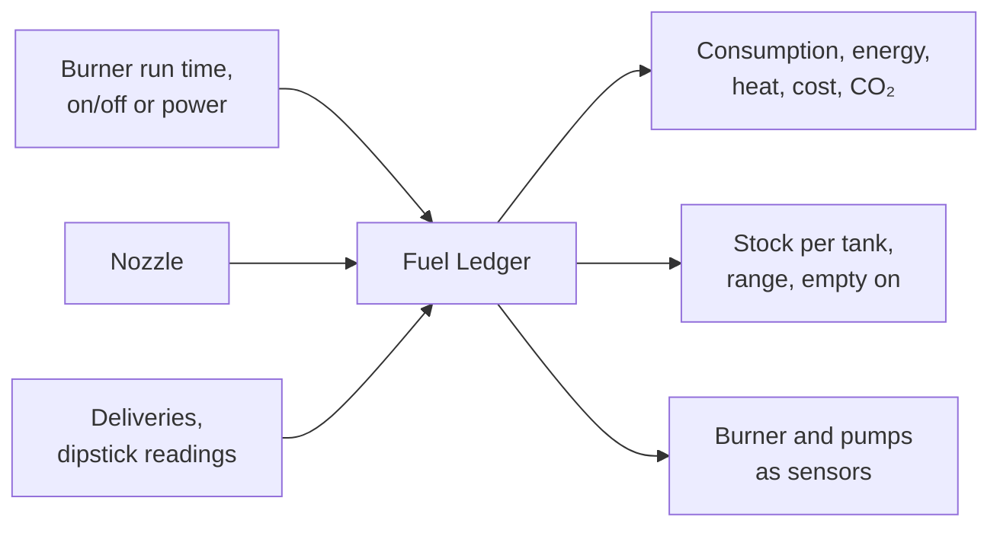
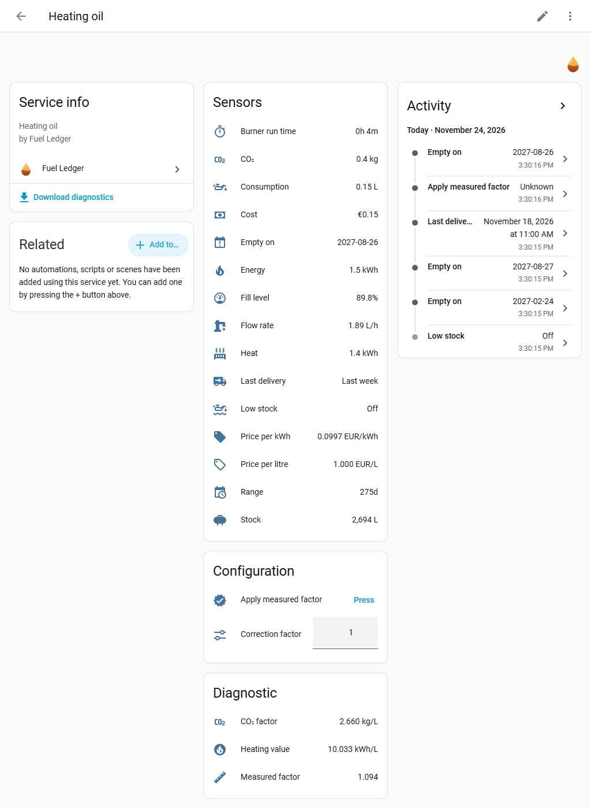

# Fuel Ledger

**How much oil does your heating use, and how long will the tanks last?** Most oil heatings have no meter. Fuel Ledger
works it out from what Home Assistant already knows about your burner, keeps track of every tank and every delivery,
and corrects itself with the readings you take with a dipstick.

## What you get

- **Counters for the Energy dashboard**: consumption in litres, energy and heat in kWh, cost and CO₂.
- **The stock** of each tank and of all together, the fill level, the range in days and the day the tanks run empty.
- **Deliveries** with price, heating value and CO₂ from the invoice, blended with what was left in the tanks.
- **A measured correction factor** from your dipstick readings.
- **The burner and the pumps** as sensors of their own, if a power meter sits in front of the boiler.

{ .screenshot }

## What you need

- :material-home-assistant: **Home Assistant 2026.10 or newer**

- :material-fire: **Something that tells when the burner runs**

    A run time counter, a binary sensor, or the power of the boiler from a smart plug. Or an oil meter, if you have
    one.

- :material-spray: **The nozzle of the burner**

    Stamped on the nozzle and in the maintenance record, for example *0.50 GPH*. Not needed with an oil meter.

Optional, each makes it more accurate: the tanks with their size, the invoices of your deliveries, readings with a
dipstick, a level sensor. [More accurate](more-accurate.md) shows what each one brings.

## Does it fit your heating?

- :material-check: **Fits:** an oil heating with a burner that runs at one power (one stage), and some way for Home
  Assistant to know when it runs. Most oil boilers are like that.
- :material-check: **Fits, roughly:** a two-stage or modulating burner. The nozzle gives the consumption at full
  power; the measured factor brings it closer, but it stays an average.
- :material-close: **Does not fit yet:** LPG, pellets, wood. The structure is made for them, they come later.

!!! info "An estimate, and honest about it"

    Without an oil meter, Fuel Ledger calculates the consumption: run time × nozzle × correction factor. The nozzle
    alone is often 10 to 30 % off, mostly because the oil pump runs at a higher pressure than the nozzle is rated at.
    Two dipstick readings, some weeks apart, measure the factor that corrects it. Every
    result says in its attribute **Level** whether it is *measured*, *calculated* or *estimated*.

!!! success "Safe to try"

    Fuel Ledger only reads. It does not switch anything and does not go online. If you remove it, only its own
    sensors disappear.

## Next steps

1. [**Install**](installation.md) Fuel Ledger from the Marketplace of Home Assistant (5 minutes).
2. [**Set it up**](setup.md): a few short steps, then tell it what is in the tanks.
3. [**Add it to the Energy dashboard**](energy-dashboard.md).
4. Later: [**enter deliveries and readings**](deliveries-and-readings.md) as they come.
