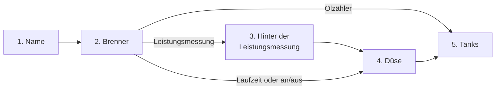
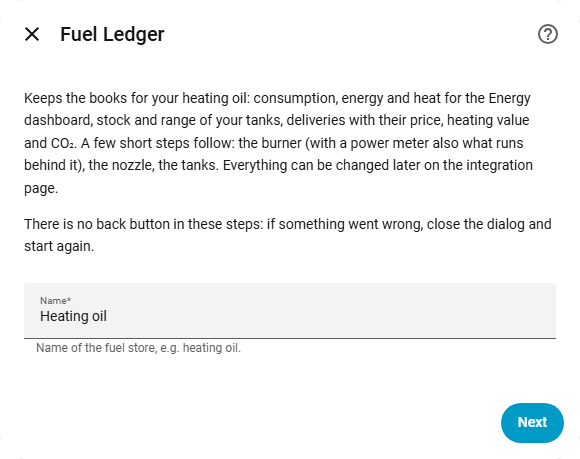
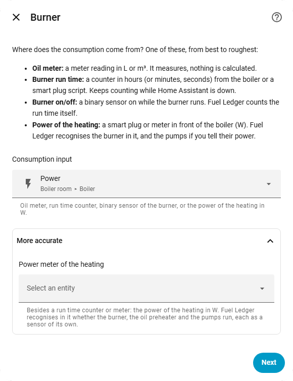
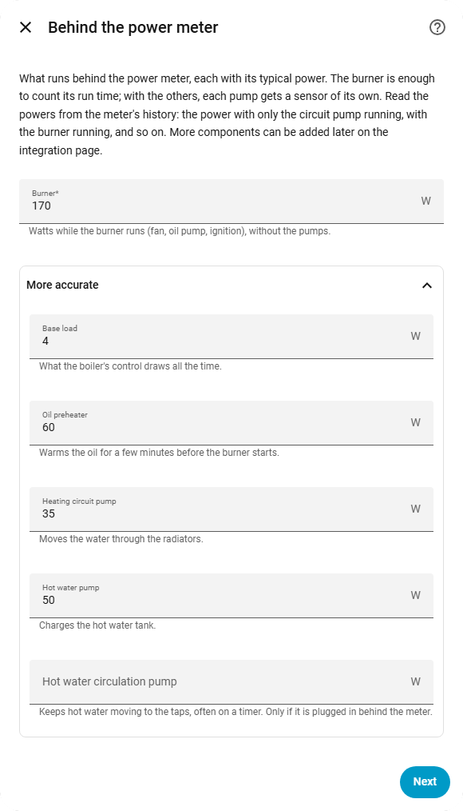
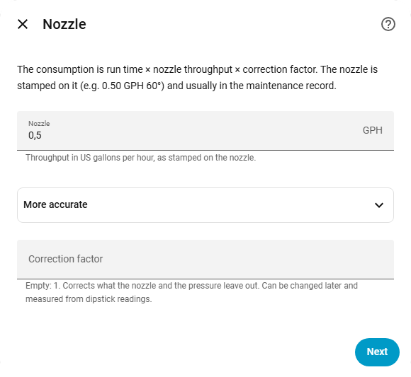
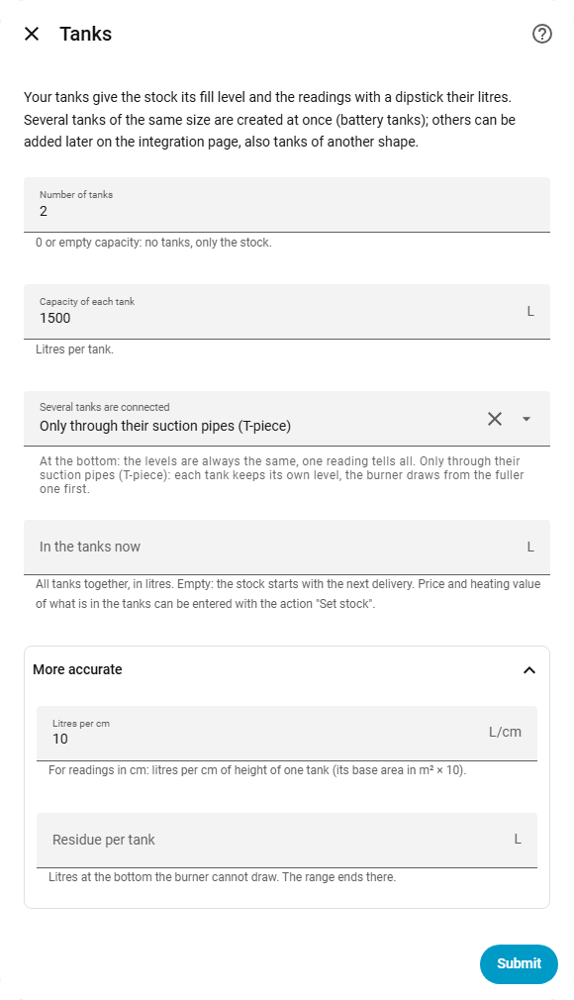
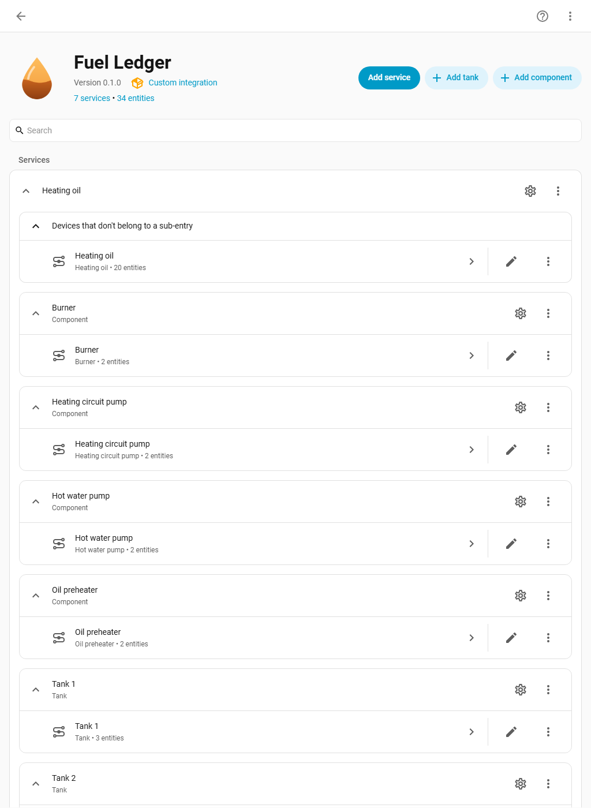

# Einrichtung

!!! abstract "Kurz gesagt"

    1. **Name**: wie du dein Öl nennst, z. B. *Heizöl*.
    2. **Brenner**: woher der Verbrauch kommt (Ölzähler, Laufzeit, an/aus oder Leistung der Heizung).
    3. **Hinter der Leistungsmessung** (nur mit Leistungsmessung): die Leistung des Brenners und, wenn du willst, die
       der Pumpen.
    4. **Düse** (nicht mit Ölzähler): wie aufgedruckt, z. B. *0.50 GPH*.
    5. **Tanks**: wie viele, wie groß, wie sie verbunden sind und was gerade drin ist.

    Alles lässt sich später ändern. Pflicht sind nur der Eingang aus Schritt 2 und, ohne Ölzähler, die Düse.

!!! tip "Es gibt keinen Zurück-Knopf"

    Ist etwas schiefgegangen, schließe den Dialog und fang neu an. Gespeichert wird erst im letzten Schritt.

## Schritt 1: Name

Wie du deinen Brennstoff nennst, zum Beispiel *Heizöl*. Daraus wird der Name des Geräts und der Anfang jedes
Entitätsnamens: *Heizöl Verbrauch*, *Heizöl Vorrat* und so weiter.

{ .screenshot }

## Schritt 2: Brenner

Woher kommt der Verbrauch? Wähle **eine** Entität, die beste, die du hast:

| Du hast | Wähle | Wie Fuel Ledger es nutzt |
|---|---|---|
| Einen Ölzähler | Seinen Zählerstand in L oder m³ | Gemessen, gerechnet wird nichts. Überspringt die Düse. |
| Einen Laufzeitzähler des Brenners | Den Zähler in Stunden, Minuten oder Sekunden | Laufzeit × Düse. Zählt weiter, auch wenn Home Assistant nicht läuft. |
| Einen Binärsensor, der *an* ist, solange der Brenner läuft | Den Binärsensor | Fuel Ledger zählt die Laufzeit selbst. |
| Nur die Leistung der Heizung | Den Leistungssensor in W | Fuel Ledger findet darin den Brenner (nächster Schritt). |

Unter **Genauer** kannst du neben einem Laufzeitzähler oder einem Ölzähler eine **Leistungsmessung der Heizung**
ergänzen. Der Zähler entscheidet dann weiter über den Verbrauch, und die Leistungsmessung ergänzt einen Sensor für den
Brenner, die Ölvorwärmung und jede Pumpe.

{ .screenshot }

??? question "Woher bekomme ich einen Laufzeitzähler oder einen Binärsensor?"

    - **Vom Kessel:** Viele Kessel melden den Brenner über ihre eigene Integration (Viessmann, Buderus, Wolf und
      andere), oft als *Brenner aktiv* oder *Brennerstunden*.
    - **Von einer Messsteckdose:** Hängt der Kessel an einer, die Leistung misst, wähle direkt ihren Leistungssensor.
      Fuel Ledger findet den Brenner darin, ganz ohne Helfer.
    - **Von einem Binärsensor am Brenner**, zum Beispiel einem Vibrations- oder Lichtsensor am Flammenfenster.

## Schritt 3: Hinter der Leistungsmessung

Nur mit Leistungsmessung, in Schritt 2 oder unter **Genauer**. Fuel Ledger braucht die typische Leistung jedes Teils,
das laufen kann, in Watt:

| Feld | Was du einträgst |
|---|---|
| **Brenner** | Watt, solange der Brenner läuft (Gebläse, Ölpumpe, Zündung), ohne die Pumpen. Pflicht, wenn die Leistungsmessung der Eingang ist. |
| **Grundlast** | Was die Kesselregelung dauernd zieht, z. B. 4 W. |
| **Ölvorwärmung** | Wärmt das Öl ein paar Minuten vor dem Start des Brenners. |
| **Heizkreispumpe** | Treibt das Wasser durch die Heizkörper. |
| **Warmwasserpumpe** | Lädt den Warmwasserspeicher. |
| **Zirkulationspumpe** | Hält warmes Wasser an den Zapfstellen bereit, oft mit Zeitschaltung. Nur, wenn sie hinter der Leistungsmessung hängt. |

Jede Komponente, die du einträgst, wird ein Gerät mit einem Binärsensor (ob sie läuft) und einem Leistungssensor.
Weitere Komponenten kannst du später auf der Seite der Integration mit **Komponente hinzufügen** ergänzen.

{ .screenshot }

??? question "Wie finde ich die typischen Leistungen?"

    Öffne den Verlauf der Leistungsmessung und sieh dir einen Tag an: Die Leistung steht auf ein paar Stufen.

    - Die unterste Stufe, die immer da ist, ist die **Grundlast**.
    - Eine Stufe, die stundenlang ein paar Dutzend Watt hoch ist, ist meist die **Heizkreispumpe**. Ihre Höhe über der
      Grundlast ist ihre Leistung.
    - Eine Stufe von ein paar Minuten direkt vor dem Start des Brenners ist die **Ölvorwärmung**.
    - Die höchste Stufe, während der Kessel feuert, ist der **Brenner** plus die Pumpen, die gleichzeitig laufen.
      Zieh sie ab.

    Runde Zahlen genügen. Zwei Pumpen mit fast gleicher Leistung lassen sich nicht unterscheiden; Fuel Ledger sagt dir
    das mit einem Hinweis unter Reparaturen.

## Schritt 4: Düse

Nicht mit Ölzähler. Der Verbrauch ist Laufzeit × Durchsatz der Düse × Korrekturfaktor.

| Feld | Was du einträgst |
|---|---|
| **Düse** | Durchsatz in US-Gallonen pro Stunde, wie auf der Düse aufgedruckt (z. B. *0.50 GPH 60°*) und im Wartungsprotokoll. |
| **Korrekturfaktor** | Leer lassen (1), wenn du es nicht besser weißt. Er wird später [aus Peilungen gemessen](deliveries-and-readings.md#der-gemessene-faktor). |

{ .screenshot }

Unter **Genauer**:

| Feld | Was du einträgst |
|---|---|
| **Pumpendruck** | Der Druck der Ölpumpe, aus dem Wartungsprotokoll oder vom Manometer. Höherer Druck verbrennt mehr. |
| **Prüfdruck der Düse** | Leer: 7 bar (100 psi), die übliche Angabe. |
| **Durchsatz** | Liter pro Stunde, falls du das statt der Düse kennst (ersetzt sie). |
| **Brenner an/aus** | Mit einem Laufzeitzähler: ein Binärsensor, der an ist, solange der Brenner läuft. Ergibt einen Live-Durchfluss. |
| **Vorbelüftung** | Mit an/aus oder Leistung: Sekunden nach jedem Start, in denen das Gebläse läuft, aber kein Öl brennt. |

## Schritt 5: Tanks

| Feld | Was du einträgst |
|---|---|
| **Anzahl Tanks** | 0, wenn du die Tanks nicht verfolgen willst, nur den Vorrat. |
| **Inhalt je Tank** | Liter. Mehrere gleich große Tanks werden auf einmal angelegt. |
| **Mehrere Tanks sind verbunden** | **Unten verbunden**: Batterietanks mit Verbindungsleitung. **Nur über die Saugleitungen (T-Stück)**: Jeder Tank behält seinen eigenen Pegel. Siehe [So funktioniert es](how-it-works.md#tanks). |
| **Jetzt in den Tanks** | Alle Tanks zusammen, in Litern, falls du es weißt. Leer: Der Vorrat beginnt mit der nächsten Lieferung oder sobald jeder Tank gepeilt ist. |

Unter **Genauer**: **Liter pro cm** eines Tanks, für Peilungen in cm (seine Grundfläche in m² × 10), und der
**Bodenrest je Tank**, den der Brenner nicht ansaugen kann.

{ .screenshot }

Die Tanks heißen *Tank 1*, *Tank 2* und so weiter. Umbenennen kannst du sie mit **Tank bearbeiten** auf der Seite der
Integration, zum Beispiel in *Links* und *Rechts*. Einen Tank anderer Form (einen liegenden Stahltank, einen Tank mit
Peiltabelle des Herstellers) legst du dort mit **Tank hinzufügen** an, siehe
[Genauer machen](more-accurate.md#tanks-anderer-form).

## Nach der Einrichtung

1. **Sag ihm, was in den Tanks ist**, falls du es nicht schon in Schritt 5 getan hast, am besten mit dem Preis, den du
   bezahlt hast: mit der Aktion **Vorrat setzen** oder einer [Peilung jedes Tanks](deliveries-and-readings.md#peilungen-mit-dem-peilstab).
2. **Trag es ins [Energie-Dashboard](energy-dashboard.md) ein.**
3. **Trag die nächste Lieferung ein**, wenn sie kommt, mit ihrer Rechnung: [Lieferungen](deliveries-and-readings.md#lieferungen).

Um später etwas zu ändern: **Einstellungen → Geräte & Dienste → Fuel Ledger**, das Zahnrad :material-cog: des
Eintrags. Im Menü stehen **Brenner und Düse**, **Brennstoff und Kessel**, **Vorrat und Reichweite** und, mit
Leistungsmessung, **Leistungsmessung**. Tanks und Komponenten bearbeitest du in ihren eigenen Zeilen auf derselben
Seite.

{ .screenshot }
