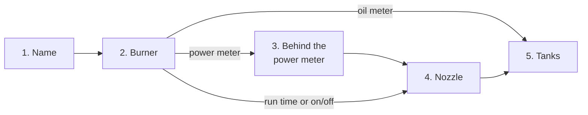

# Setup

!!! abstract "In short"

    1. **Name**: what you call your oil, e.g. *Heating oil*.
    2. **Burner**: where the consumption comes from (oil meter, run time, on/off, or power of the heating).
    3. **Behind the power meter** (only with a power meter): the burner's power, and optionally the pumps'.
    4. **Nozzle** (not with an oil meter): as stamped on it, e.g. *0.50 GPH*.
    5. **Tanks**: how many, how big, how they are connected, and what is in them now.

    Everything can be changed later. Required are only the input of step 2 and, without an oil meter, the nozzle.

!!! tip "There is no back button"

    If something went wrong, close the dialog and start again. Nothing is saved until the last step.

## Step 1: Name

What you call your fuel, for example *Heating oil*. It becomes the name of the device and the start of every entity
name: *Heating oil Consumption*, *Heating oil Stock* and so on.

## Step 2: Burner

Where does the consumption come from? Choose **one** entity, the best you have:

| You have | Choose | How Fuel Ledger uses it |
|---|---|---|
| An oil meter | Its reading in L or m³ | Measured, nothing is calculated. Skips the nozzle. |
| A run time counter of the burner | The counter in hours, minutes or seconds | Run time × nozzle. Keeps counting while Home Assistant is down. |
| A binary sensor *on* while the burner runs | The binary sensor | Fuel Ledger counts the run time itself. |
| Only the power of the heating | The power sensor in W | Fuel Ledger finds the burner in it (next step). |

Under **More accurate** you can add a **power meter of the heating** next to a run time counter or an oil meter. The
counter then still decides the consumption, and the power meter adds a sensor for the burner, the oil preheater and
each pump.

??? question "Where do I get a run time counter or a binary sensor?"

    - **From the boiler:** many boilers report the burner through their own integration (Viessmann, Buderus, Wolf
      and others), often as *burner active* or *burner hours*.
    - **From a smart plug:** if the boiler is plugged into one that measures power, choose the power sensor itself.
      Fuel Ledger finds the burner in it, no helper needed.
    - **From a binary sensor on the burner**, for example a vibration or light sensor on the flame window.

## Step 3: Behind the power meter

Only with a power meter, in step 2 or under **More accurate**. Fuel Ledger needs the typical power of each part that
can run, in watts:

| Field | What to enter |
|---|---|
| **Burner** | Watts while the burner runs (fan, oil pump, ignition), without the pumps. Required if the power meter is the input. |
| **Base load** | What the boiler's control draws all the time, e.g. 4 W. |
| **Oil preheater** | Warms the oil for a few minutes before the burner starts. |
| **Heating circuit pump** | Moves the water through the radiators. |
| **Hot water pump** | Charges the hot water tank. |
| **Hot water circulation pump** | Keeps hot water moving to the taps, often on a timer. Only if it is plugged in behind the meter. |

Each component you enter becomes a device with a binary sensor (whether it runs) and a power sensor. More components
can be added later on the integration page with **Add component**.

??? question "How do I find the typical powers?"

    Open the history of the power meter and look at a day: the power stands on a few steps.

    - The lowest step that is always there is the **base load**.
    - A step that lasts for hours at a few dozen watts is usually the **heating circuit pump**. Its height above the
      base load is its power.
    - A step of a few minutes right before the burner starts is the **oil preheater**.
    - The highest step, while the boiler fires, is the **burner** plus the pumps that run at the same time.
      Subtract them.

    Round numbers are fine. Two pumps with almost the same power cannot be told apart; Fuel Ledger tells you so with
    a repair note.

## Step 4: Nozzle

Not with an oil meter. The consumption is run time × nozzle throughput × correction factor.

| Field | What to enter |
|---|---|
| **Nozzle** | Throughput in US gallons per hour, as stamped on the nozzle (e.g. *0.50 GPH 60°*) and in the maintenance record. |
| **Correction factor** | Leave it empty (1) if you do not know better. It is [measured from dipstick readings](deliveries-and-readings.md#the-measured-factor) later. |

Under **More accurate**:

| Field | What to enter |
|---|---|
| **Pump pressure** | The pressure of the oil pump, from the maintenance record or the gauge. A higher pressure burns more. |
| **Test pressure of the nozzle** | Empty: 7 bar (100 psi), the usual rating. |
| **Throughput** | Litres per hour, if you know it instead of the nozzle (it replaces it). |
| **Burner on/off** | With a run time counter: a binary sensor that is on while the burner runs. Gives a live flow rate. |
| **Prepurge** | With on/off or power: seconds after each start in which the fan runs but no oil burns. |

## Step 5: Tanks

| Field | What to enter |
|---|---|
| **Number of tanks** | 0 if you do not want to follow the tanks, only the stock. |
| **Capacity of each tank** | Litres. Several tanks of the same size are created at once. |
| **Several tanks are connected** | **At the bottom**: battery tanks with a connecting pipe. **Only through their suction pipes (T-piece)**: each tank keeps its own level. See [How it works](how-it-works.md#tanks). |
| **In the tanks now** | All tanks together, in litres, if you know it. Empty: the stock starts with the next delivery, or once every tank is read. |

Under **More accurate**: **Litres per cm** of one tank, for readings in cm (its base area in m² × 10), and the
**Residue per tank** the burner cannot draw from the bottom.

The tanks are called *Tank 1*, *Tank 2* and so on. Rename them with **Edit tank** on the integration page, for
example *Left* and *Right*. A tank of another shape (a steel tank on its side, a tank with a manufacturer's table) is
added there with **Add tank**, see [More accurate](more-accurate.md#tanks-of-another-shape).

## After the setup

1. **Tell it what is in the tanks**, if you did not in step 5, best with the price you paid: the action **Set stock**,
   or a [reading of each tank](deliveries-and-readings.md#readings-with-a-dipstick).
2. **Add it to the [Energy dashboard](energy-dashboard.md).**
3. **Enter the next delivery** when it comes, with its invoice: [Deliveries](deliveries-and-readings.md#deliveries).

To change anything later: **Settings → Devices & services → Fuel Ledger**, the gear icon :material-cog: of the entry.
The menu has **Burner and nozzle**, **Fuel and boiler**, **Stock and range** and, with a power meter, **Power
meter**. Tanks and components are edited in their own rows on the same page.
